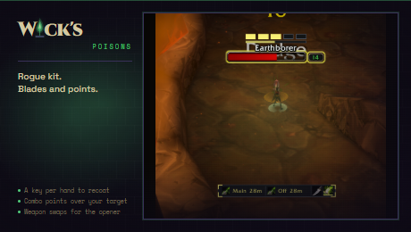

# Wick's Poisons and Things

<!-- wick:badges:start -->

<!-- wick:badges:end -->

> Rogue loadout kit for World of Warcraft: Forever. Poison watch with one-key coating, talents, pre-pull checklist, racials.

Part of the **[Wick suite](https://github.com/Wicks-mods/WickSuite)**: precision addons built around a single fel-green-on-deep-purple aesthetic. Built on [WickCore](https://github.com/Wicks-mods/WickCore).

## What it is

Coating a blade is the chore a rogue repeats all night, and the client is
happy to talk about it out of combat. So that is what this kit watches.

- **Blade watch.** What coats each hand, how long it has left, how many
  charges remain. Green while it holds, amber as it runs down, red when a
  blade is bare.
- **Coating keys.** One per hand. Each applies the coating you pin, or the
  best one you are carrying, by using it and then the weapon slot. The
  macro is rewritten out of combat, so it follows what you loot.
- **Compact strip.** Both blades on one row, meant to stay on screen.
  Click a blade to recoat it, hover for detail, right-click for the panel.
- **Talents.** Export the active build as a Blizzard import string, import
  a string as a new loadout, save builds to an account-wide library, apply
  one with a click.
- **Pre-pull checklist.** Main hand coated, off hand coated, coatings
  carried, Stealth. Rows go quiet the moment combat starts.
- **Racials.** Your race's actives as cast buttons with cooldown display.

## Install

Requires **[WickCore](https://github.com/Wicks-mods/WickCore)**. Extract both
folders into the Forever client's `Interface\AddOns\`.

## Usage

Bind **Coat main hand**, **Coat off hand** and **Toggle poison panel** under
Key Bindings, AddOns, Wick's Poisons and Things.

| Command | Effect |
|---|---|
| `/wpt` | Poison panel |
| `/wpt kit` | Talents, checklist, racials |
| `/wpt strip` | Show or hide the compact strip |
| `/wpt unlock` / `lock` | Move the strip |
| `/wpt warn <minutes>` | Amber under this many minutes |
| `/wpt pin main [item link]` | Always apply this coating to that hand |
| `/wpt status` | Diagnostics |

`/wpoisons` is an alias.

## Compatibility

World of Warcraft: Forever, 1.60.x, Interface 16001. Requires WickCore.

## More from Wick

<!-- wick:suite-table:start -->
| Addon | GitHub | CurseForge |
|---|---|---|
| **WickCore** | [repo](https://github.com/Wicks-mods/WickCore) | [CurseForge](https://www.curseforge.com/wow/addons/wickcore) |
| **Wick's Comforts** | [repo](https://github.com/Wicks-mods/WicksComforts) | [CurseForge](https://www.curseforge.com/wow/addons/wicks-comforts) |
| **Wick's Beasts and Things** | [repo](https://github.com/Wicks-mods/WicksBeastsAndThings) | [CurseForge](https://www.curseforge.com/wow/addons/wicks-beasts-and-things) |
| **Wick's Stances and Things** | [repo](https://github.com/Wicks-mods/WicksStancesAndThings) | [CurseForge](https://www.curseforge.com/wow/addons/wicks-stances-and-things) |
| **Wick's Seals and Things** | [repo](https://github.com/Wicks-mods/WicksSealsAndThings) | [CurseForge](https://www.curseforge.com/wow/addons/wicks-seals-and-things) |
| **Wick's Conjures and Things** | [repo](https://github.com/Wicks-mods/WicksConjuresAndThings) | [CurseForge](https://www.curseforge.com/wow/addons/wicks-conjures-and-things) |
| **Wick's Poisons and Things** | [repo](https://github.com/Wicks-mods/WicksPoisonsAndThings) | [CurseForge](https://www.curseforge.com/wow/addons/wicks-poisons-and-things) |
| **Wick's Demons and Things** | [repo](https://github.com/Wicks-mods/WicksDemonsAndThings) | [CurseForge](https://www.curseforge.com/wow/addons/wicks-demons-and-things) |
| **Wick's Bags** | [repo](https://github.com/Wicks-mods/WicksBags) | [CurseForge](https://www.curseforge.com/wow/addons/wicks-bags) |
| **Wick's Trade Hall** | [repo](https://github.com/Wicks-mods/WicksTradeHall) | [CurseForge](https://www.curseforge.com/wow/addons/trade-hall) |
| **Wick's Gear** | [repo](https://github.com/Wicks-mods/WicksGear) | [CurseForge](https://www.curseforge.com/wow/addons/wicks-gear) |
| **Wick's UI** | [repo](https://github.com/Wicks-mods/WicksUIForever) | [CurseForge](https://www.curseforge.com/wow/addons/wicks-ui) |
| **Wick's Reminders** | [repo](https://github.com/Wicks-mods/WicksReminders) | [CurseForge](https://www.curseforge.com/wow/addons/wicks-reminders) |
| **Wick's Map** | [repo](https://github.com/Wicks-mods/WicksMap) | [CurseForge](https://www.curseforge.com/wow/addons/wicks-map) |

**Community:** [Discord](https://discord.gg/GWGTMhYBZY)
<!-- wick:suite-table:end -->

## License

MIT for code (see [LICENSE](LICENSE)). Brand chrome and the "Wick's" wordmark are trademarked, see [TRADEMARK.md](https://github.com/Wicks-mods/WickSuite/blob/main/TRADEMARK.md). Racial data from [talentsforever.com](https://talentsforever.com) (CC BY 4.0) via WickCore.
